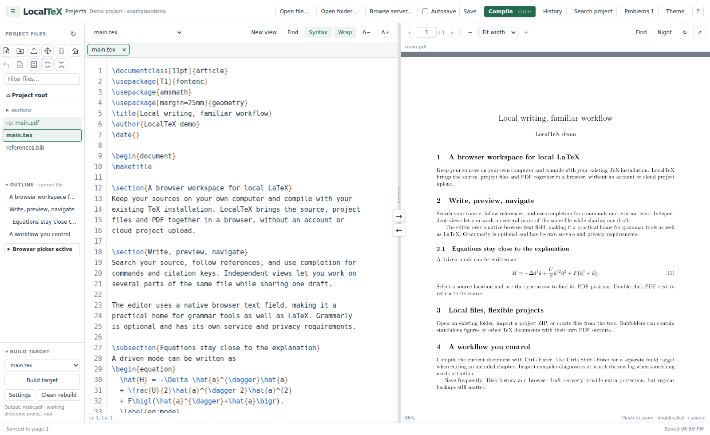

# LocalTeX

**Local LaTeX. Browser editing. Grammarly-friendly.**

LocalTeX is an offline LaTeX workspace that runs in your browser and compiles with your own TeX installation. Keep your existing folders, edit source and preview PDFs side by side, and use Grammarly alongside your writing—without moving the project into an online editor.



*Actual LocalTeX interface with the included demo project. Grammarly is not installed in this screenshot.*

## Why LocalTeX?

Desktop LaTeX tools are excellent at compilation, but integrating writing assistants can be awkward. LocalTeX keeps a native browser text field for editing, giving Grammarly's browser or desktop integration a familiar surface while retaining LaTeX-specific tools around it.

- **A complete local workflow:** source editing, native compilation, independent PDF zoom, resizable panes and bidirectional SyncTeX.
- **Comfortable writing:** syntax colors, soft wrapping, environment indentation, command/citation completion, TikZ suggestions, and source/project search.
- **Flexible views:** multiple views of one file share a single draft; reorder tabs, switch with shortcuts, or edit several positions with Ctrl+click.
- **Your folders, your targets:** file/folder creation, uploads, drag moves, images, project ZIP import/export, and independent build targets for chapters and figures.
- **Debugging and recovery:** navigable error/warning lists, searchable live logs, cancellable builds, atomic saves, per-file disk snapshots and browser draft recovery.

No account, cloud project storage, WSL, Docker, Node.js or third-party Python packages are needed to **run** LocalTeX. Its frontend assets are bundled; editing, compiling and PDF preview work without an internet connection once your TeX distribution and required packages are installed.

**Grammarly is optional and separate.** Its availability depends on the browser, extension/desktop app and Grammarly service; underlines can occasionally drift with wrapping or scrolling. LocalTeX is not an official Grammarly integration or an affiliated product. Grammarly may send text to its service: LocalTeX's offline operation does not make third-party writing assistants offline or private.

## Get started

1. Download/unpack the project or clone this repository.
2. Install Python and a native TeX distribution if you do not already have them.
3. From the LocalTeX folder, run:

```sh
python server.py
```

On systems where the command is named `python3`, use that instead. The server opens your default browser. The projects page lets you open a file/folder, choose a recent project, or import a ZIP. You can also start directly:

```sh
python server.py "/path/to/project"
```

Try the included demo with `python server.py examples/demo`. Use the URL printed by the server; the default port is **8765**, with automatic fallback if it is occupied.

## Requirements

| Requirement | Details |
| --- | --- |
| Python | **3.8 or newer**, standard library only. Prefer a currently supported Python release; 3.8 is retained for compatibility. Python is not bundled. |
| Browser | A modern browser with JavaScript enabled. Automated UI tests run in Chromium; other browsers need manual verification. |
| Local TeX | TeX Live, MiKTeX, MacTeX or another native distribution with the chosen `pdflatex`, `xelatex` or `lualatex` engine. |
| Reliable builds | **latexmk is strongly recommended** for repeated passes and bibliography processing. Install BibTeX/Biber as required by your project. Without latexmk, LocalTeX runs the selected engine once. |
| Source/PDF navigation | `synctex` must be available for SyncTeX. Imported PDFs may have no source mapping. |
| Native file picker | Optional Tkinter/Tcl-Tk and a graphical desktop. Browser-based picking works without it. |

TeX tools are found on `PATH`. If yours live elsewhere, use the UI’s **TeX directory** control in the UI or:

```sh
python server.py --tex-path "/path/to/tex/bin"
```

Missing tools and picker dependencies are reported at startup. LocalTeX does not install dependencies automatically. It is designed for Windows, Linux and macOS; see [development and verification](docs/development.md) for what has actually been tested.

## Everyday controls

| Shortcut / control | Action |
| --- | --- |
| Ctrl+S | Save opened drafts |
| Ctrl+Enter | Compile the current source file |
| Ctrl+Shift+Enter | Compile the separate build target |
| Ctrl+F | Find in the source/PDF pane, or the focused raw log |
| Ctrl+Shift+F | Search across project files |
| Ctrl+click / Ctrl+D | Add cursors / select the next occurrence |
| Ctrl+Alt+N | Add another view of the current file |
| Ctrl+Alt+Left / Right | Switch editor views |
| Middle-click an editor tab | Close that view |
| Divider arrows / PDF double-click | Navigate between source and PDF |

Use the **?** button for more shortcuts. Most Ctrl shortcuts also accept Cmd on macOS; view-switching combinations are platform-dependent. [User guide](docs/user-guide.md) covers files, builds, recovery and troubleshooting.

## Remote use and limitations

LocalTeX is a **single-user local application**, not a hosted multi-user service. Remote use is supported through a private SSH tunnel. The picker and compilation then operate on the server's files, not the browser computer's files. See the [CLI and SSH guide](docs/cli.md).

- The server listens on loopback. Host/Origin checks are safeguards, **not authentication**. Do not expose it through a public proxy or shared tunnel.
- Compile only trusted projects. TeX and latexmk run with your account's permissions; ZIP validation is not a compiler sandbox.
- Browser tabs are independent sessions. Views inside one tab share drafts; separate browser tabs are not collaborative editors and can encounter save conflicts.
- Browser recovery depends on storage permissions and the browser profile/URL. When storage is unavailable, editing and disk saves still work, but a persistent notice identifies the unavailable backup or view storage.
- Saved history and trash consume disk space and are not automatically pruned. Project ZIP export excludes recovery history and trash; back up the full folder separately if you need them.
- Large PDFs/files are currently served in full, and history listing reads snapshots. Very large projects can use substantial memory. Native picker behavior, physical trackpad gestures and Grammarly are not covered by automated browser tests.

**Beta software:** keep regular backups. Current safeguards reduce risks; they cannot guarantee recovery after disk failure, forced process termination or external programs modifying files.

## Documentation and licensing

- [CLI reference and remote use](docs/cli.md)
- [User guide and troubleshooting](docs/user-guide.md)
- [Development, tests and architecture](docs/development.md)
- [Security model](SECURITY.md)
- [Third-party licenses and provenance](THIRD_PARTY_NOTICES.md)

LocalTeX's original code, documentation and demo are licensed under **[Apache-2.0](LICENSE)**. Bundled PDF.js, CMaps and fonts retain their respective licenses and notices. LocalTeX does not bundle Python, a TeX distribution or Grammarly.
